<table border="0" width="100%">
  <tr>
    <td width="270" align="center" valign="middle">
      
    </td>
    <td valign="middle">
      <h3>Hey, I'm Harsh! 👋</h3>
      
<strong>Full Stack Software Developer</strong> 
      Building applications, backend systems and exploring new technologies.

      

        <strong>Technology stack:</strong> 
        <code>Python</code> · <code>FastAPI</code> · <code>Flask</code> · <code>React</code> · <code>Flutter</code> · <code>PostgreSQL</code> · <code>Java</code> · <code>Firebase</code>
      

      
<strong>Location:</strong> Navi Mumbai, India.

      

        
        &nbsp;
        <!-- Replace with your LinkedIn profile URL -->
        
      

    </td>
  </tr>
</table>

## ⚡ Technology Stack

<table border="0" width="100%">
  <tr>
    <td width="50%" align="center" valign="top">
      
    </td>
    <td width="50%" align="center" valign="top">
      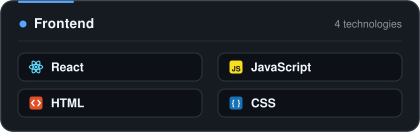
    </td>
  </tr>
  <tr>
    <td width="50%" align="center" valign="top">
      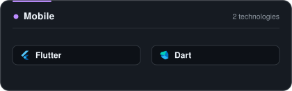
    </td>
    <td width="50%" align="center" valign="top">
      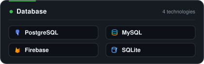
    </td>
  </tr>
  <tr>
    <td width="50%" align="center" valign="top">
      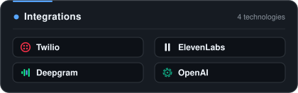
    </td>
    <td width="50%" align="center" valign="top">
      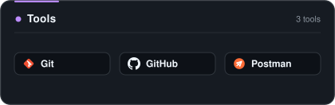
    </td>
  </tr>
</table>

## 🧩 Engineering Focus

<table border="0" width="100%">
  <tr>
    <td width="50%" align="center" valign="top">
      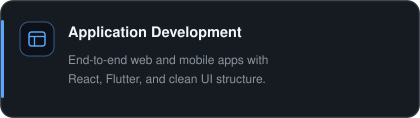
    </td>
    <td width="50%" align="center" valign="top">
      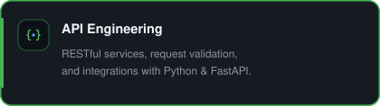
    </td>
  </tr>
  <tr>
    <td width="50%" align="center" valign="top">
      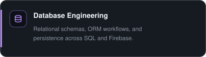
    </td>
    <td width="50%" align="center" valign="top">
      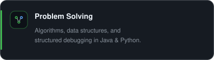
    </td>
  </tr>
</table>

## 🚀 Featured Projects

<table border="0" width="100%">
  <tr>
    <td width="50%" align="center" valign="top">
      <picture>
        <source media="(prefers-color-scheme: dark)" srcset="assets/card-dsa_maxing-dark.svg">
        <source media="(prefers-color-scheme: light)" srcset="assets/card-dsa_maxing-light.svg">
        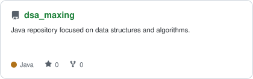
      </picture>
    </td>
    <td width="50%" align="center" valign="top">
      <picture>
        <source media="(prefers-color-scheme: dark)" srcset="assets/card-PGlife-master-dark.svg">
        <source media="(prefers-color-scheme: light)" srcset="assets/card-PGlife-master-light.svg">
        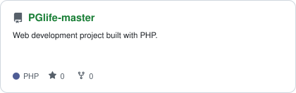
      </picture>
    </td>
  </tr>
</table>

## 📊 GitHub Dashboard

  

<table border="0" width="100%">
  <tr>
    <td width="50%" align="center" valign="middle">
      
    </td>
    <td width="50%" align="center" valign="middle">
      
    </td>
  </tr>
</table>

## 🔭 Currently Exploring

  

  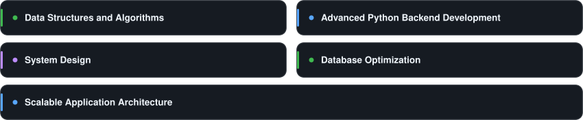

## 🐍 Contribution Snake

<picture>
  <source media="(prefers-color-scheme: dark)" srcset="https://raw.githubusercontent.com/Harshnakti16-cmd/Harshnakti16-cmd/output/snake-dark.svg">
  <source media="(prefers-color-scheme: light)" srcset="https://raw.githubusercontent.com/Harshnakti16-cmd/Harshnakti16-cmd/output/snake.svg">
  
</picture>

---

  
  &nbsp;
  <!-- Replace with your LinkedIn profile URL -->
  
  &nbsp;
  

  <em>Building. Learning. Shipping.</em>

